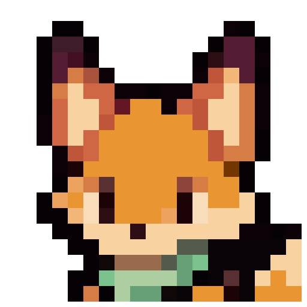
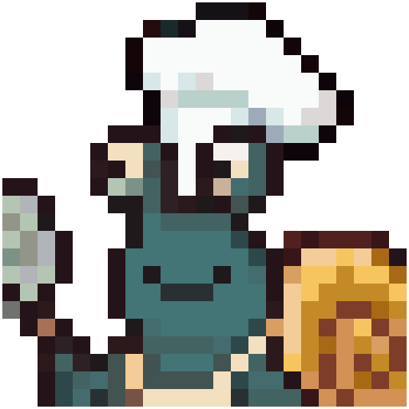
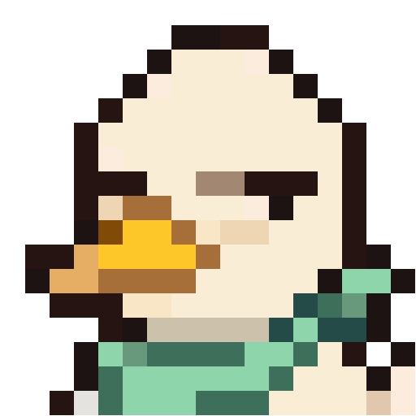
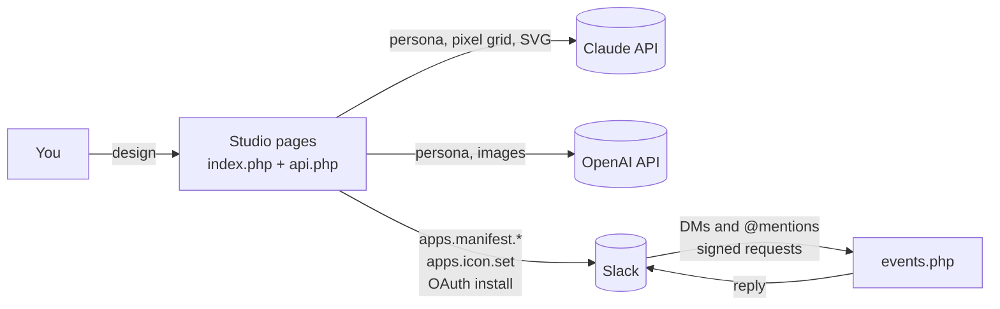

<p align="center"></p>

# Bot Lab

**Design an AI teammate for Slack in a couple of minutes.** Describe the role you want, like "a blunt critic who reviews my writing", and Bot Lab writes the character, draws its avatar and lets you crop it. Then it creates and installs a real Slack app for the bot, which chats in DMs and channels using Claude or OpenAI.

Bot Lab is self-hosted. It's one small PHP app that runs on almost any web host (cheap shared hosting included), and it uses your own API keys.

<p align="center">
  
  
  
</p>
<p align="center"><i>The bots that started it: Fixel Fox fixes things, Doughbert the chef cooks up ideas, and Judgemental Duck gives blunt feedback.</i></p>

## What it does

### Write the bot with AI
- **One sentence in, a whole bot out.** The AI writes:
  - the name
  - the personality (system prompt)
  - the Slack descriptions, kept within Slack's length limits
  - a card color
  - a description of the character's look
- **Tweak instead of starting over.** Type a request ("shorter and more sarcastic"), or use quick buttons like *Funnier* or *More professional*. Only what you asked for changes. Regenerate and Undo are always there, and every field stays editable by hand.

### Give it a face
- **Seven avatar styles:**

  | Style | Claude | OpenAI |
  |---|:-:|:-:|
  | Pixel art | ✅ draws a 32×32 grid, rendered to PNG | ✅ |
  | Flat vector, Line art, Low poly, No style | ✅ writes SVG | ✅ |
  | Painted, 3D clay | | ✅ |

  Claude can't generate images, so for these styles it draws the art as data instead: a pixel grid or SVG markup. You can also upload your own picture.
- **Face cropper.** Drag a square over the face and see the finished icon live. Pixel art is scaled up with nearest-neighbor so it stays crisp. Your original image and crop are saved, so you can recrop any time.
- **Two colors, clearly separated:**
  - the **icon background** (behind the character)
  - the **Slack card color** (the banner on the bot's profile)

  A live preview of the Slack card warns you if its white text would be hard to read.

### Make it capable
- **Abilities, switched on per bot:**
  - **Sees images** shared in Slack.
  - **Reads links** pasted into the chat.
  - **Searches the web.**

  Links and search use Anthropic's server-side web tools, and bots are told to report only what a page or search result actually says.
- **Claude or OpenAI, per bot,** with any model you like. Defaults: Claude Haiku for chatting, a stronger model for writing and drawing.
- **Try it before you ship it** in a built-in test chat.

### Put it in Slack in one click
- Bot Lab creates the app with Slack's [App Manifest API](https://docs.slack.dev/reference/methods/apps.manifest.create), which sets the name, descriptions, colors, permissions and events. It uploads the icon, then sends you to Slack to approve the install.
- **Edits sync back to Slack:** name, descriptions, color and icon. Personality changes take effect on the next message.
- **Bring existing apps:** import a hand-made app, link its App ID, and manage it from Bot Lab too. Bot Lab checks which permissions each app actually has and tells you when Slack needs a reinstall.
- **Deleting a bot** in Bot Lab deletes its Slack app.

## How it works



- **Slack's Events API, not Socket Mode.** Slack sends each DM or @mention to `events.php?bot=<slug>` as a signed HTTPS request, so no long-running process is needed. That's what makes shared hosting work.
- **Fast acknowledgment.** Slack expects an answer within 3 seconds, and AI replies take longer. The endpoint checks the signature, answers Slack immediately, then writes the reply in the same request (using `litespeed_finish_request` / `fastcgi_finish_request`).
- **Memory.** In DMs, the bot reads the last 20 messages for context. In channels it answers @mentions in a thread.
- **Storage.** Everything lives in one SQLite file. Slack tokens and secrets are encrypted with libsodium.

## Quickstart

You need:
- a host with **PHP 8.2+** (with the curl, gd, pdo_sqlite and sodium extensions), **HTTPS** and SSH, plus Composer
- an Anthropic and/or OpenAI API key
- a Slack workspace where you can create apps

1. **Get the code and install:**
   ```bash
   git clone https://github.com/GoodChancer/bot-lab.git
   cd bot-lab && composer install --no-dev
   ```
2. **Serve only the `public/` folder.** Point a domain or subfolder at `public/`. On shared hosting, `dev/deploy.sh` copies `public/` into your web folder and keeps everything else outside it (settings in `deploy.conf`, see `deploy.conf.example`).
3. **Configure:** run `php bin/setup.php`. It asks for the studio's URL, an owner password and your API keys, then writes `config.php`.
4. **Connect Slack:** sign in and open **Settings**. Paste an [app configuration token](https://api.slack.com/apps): the refresh token from "Your App Configuration Tokens". Bot Lab keeps it fresh automatically.
5. **Make a bot:** go to **New bot**, describe a role, generate, crop, then choose **Create in Slack** and approve the install.

**Moving to a new address later?** Deploy `public/` to the new place, then run `php bin/change-url.php https://new/address`. It updates the config and every bot's Slack app.

### Costs

- **Chatting** uses a small model by default (`claude-haiku-5-5` or `gpt-5-mini`), so a reply costs a fraction of a cent.
- **Generating** a persona or avatar uses a stronger model and costs a few cents.
- **Web search** is billed per search by your provider.
- You can change all the models in `config.php`.

## Security notes

- **One owner.** The studio has a single owner password (bcrypt), a session cookie, a CSRF token on every change, and login rate limiting.
- **Signed requests only.** Every Slack request is checked against that bot's signing secret, with a 5-minute replay window.
- **Encrypted secrets.** Bot tokens, signing secrets and the Slack config token are encrypted at rest. API keys stay in `config.php`, outside the web root.
- **Safe SVGs.** Generated SVGs have scripts, event handlers and external links stripped out, and are only ever shown as images.
- **Untrusted web content.** Web pages and search results are treated as information, not instructions.
- **Nothing stored from conversations.** Messages aren't saved. Bots read recent DM history from Slack when they reply.

## Project layout

```
public/          the only web-facing folder: studio pages, api.php, events.php (Slack), oauth.php
src/             Config, Db (SQLite), Crypto, Auth, Bots, Reply
  Ai/            Provider interface, ClaudeProvider (official SDK), OpenAiProvider, Generator
  Slack/         Events (signatures, history), Manifest, Apps (create/icon/install/update/delete), WebApi
bin/             setup.php, change-url.php, import-legacy.php
tests/           PHPUnit tests
dev/deploy.sh    rsync deploy for shared hosting
```

## Development

```bash
composer install
php bin/setup.php                  # use http://localhost:8765 as the URL
php -S localhost:8765 -t public
vendor/bin/phpunit
```

Slack can't reach `localhost`, so creating apps and receiving messages need a deployed copy with HTTPS. Everything else works locally: writing, drawing, cropping and the test chat.

## License

MIT
